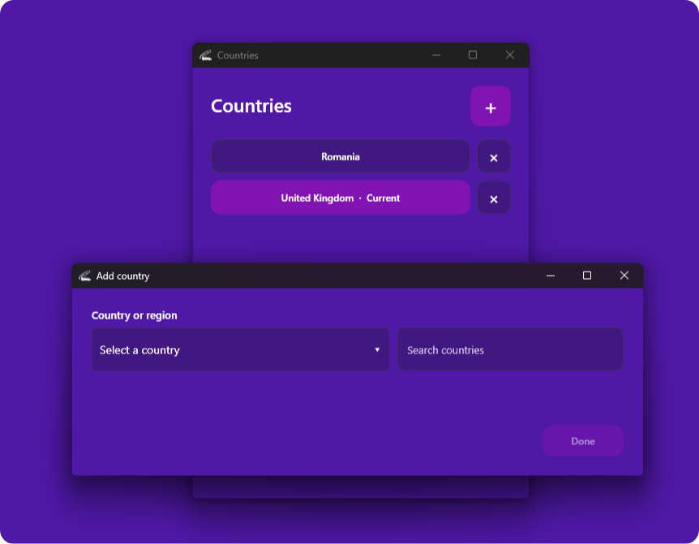

# TireMark

TireMark is a free Windows desktop app that helps drivers organize vehicle paperwork. It brings vehicles and their records together in one garage, making it easy to track inspections, insurance, road taxes, and renewal dates. Users can review each record’s status and history without searching through papers or trying to remember expiry dates.

The app supports multiple country profiles, with document categories and names adapted to the selected country. Its interface language is separate, letting users navigate in their preferred language while keeping local document terms. TireMark also offers light and dark themes, customizable colors, and adjustable text size, so users can tailor the app to their preferences.

## Features

### Manage multiple vehicles

Keep your vehicles in one garage, add a photo to each car, and drag cards into the order you want.

See garage sorting and vehicle editing

  

### Track inspections, insurance, and road taxes

Check which documents are valid, due soon, or already expired. Open any vehicle to see renewal dates and review its document history.

### Keep separate garages for different countries

Switch between country profiles to see local document names and categories. Choose the app language independently of the active country.

  

### Customize your garage and set reminders

- Adjust button and background colors, brightness, and text size.
- Switch between standard and compact cards, and choose whether to show the VIN and registration number.
- Set how many days before expiry a document is flagged, and schedule reminders as TireMark pop-ups on Windows or system notifications on Android.
- Export and import `.tiremark` files to back up your garage or transfer your vehicles, photos, document history, and custom order between Windows and Android.

  

## Download

Download the latest version from [GitHub Releases](https://github.com/andronachematei28/TireMark/releases/latest).

## License

TireMark is licensed under the GNU General Public License v3.0. See [LICENSE](LICENSE).

## Credits

TireMark was conceived, planned, and directed by andronachematei28, who defined its purpose, features, and overall product direction. The implementation was developed with assistance from AI tools. That assistance helped turn the project’s requirements into a working Windows application, including its WPF interface, SQLite database and vehicle document history, country-specific document categories, multilingual support, and customizable appearance settings. AI was also used to investigate bugs, refine layouts, and improve how the application’s windows work together. Throughout development, andronachematei28 provided the original ideas, priorities, feedback and product decisions. TireMark remains an independent project owned by andronachematei28.
